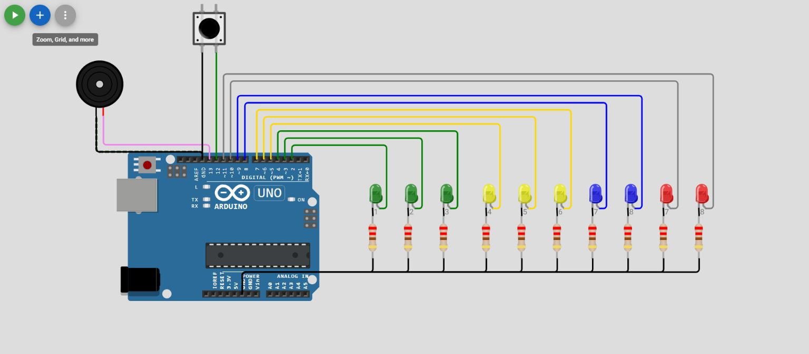

# Projeto-3 — Experimento com Arduino Uno

> Roteiro didático elaborado a partir dos arquivos originais. **Não há confirmação de compilação ou simulação executada.**

## Objetivo

Estudar o circuito do projeto **Projeto-3** e relacionar as conexões dos componentes à lógica implementada em C/C++ para Arduino.

## Componentes encontrados no circuito

- **arduino-uno**: 1
- **led**: 10
- **resistor**: 10
- **buzzer**: 1
- **pushbutton**: 1

O arquivo de diagrama contém **23 componentes** e **34 conexões** declaradas.

## Recursos identificados no código

- leitura digital
- saída digital
- sinal sonoro
- monitor serial

### Constantes identificadas

- `QTD_LEDS: 10`
- `PUSH: 12`
- `BUZZER: 13`

## Arquivos do projeto

- [Circuito Wokwi — diagram.json](diagram.json)
- [Código Arduino — src/main.cpp](src/main.cpp)
- [Configuração PlatformIO](platformio.ini)

## Roteiro de estudo

1. Abra esta pasta individual no VS Code com a extensão PlatformIO.
2. Consulte `diagram.json` e identifique os componentes e suas conexões.
3. Abra `src/main.cpp` e associe cada pino configurado ao circuito.
4. Execute **PlatformIO: Build**; em seguida, abra o projeto no Wokwi, se o ambiente estiver configurado.
5. Compare o comportamento observado com o código e registre eventuais divergências.

## Atividade para alunos

Desenhe um esquema simplificado das ligações principais, descreva a função de cada componente e explique o que ocorre na função `loop()`. Depois, proponha uma pequena modificação do experimento.

**Status:** documentação baseada no repositório; testes físicos ou virtuais pendentes.

## Captura do circuito no Wokwi

Captura autêntica do editor web a partir do diagrama original. **Simulação não executada nesta captura.** [Origem e versão dos diagramas](../../docs/GUIA_IMAGENS.md).

[← Voltar ao catálogo](../../README.md)
