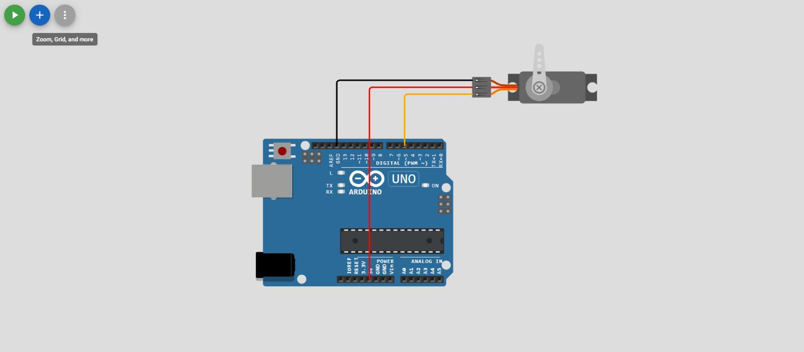

# Projeto-6 — Controle de servomotor

**Projeto educacional com Arduino Uno, Wokwi e PlatformIO.**

## Objetivo

Introdução à biblioteca Servo.h e aos comandos de posicionamento angular.

## Arquivos

- [Circuito Wokwi](diagram.json) — componentes e ligações declaradas.
- [Código C++](src/main.cpp) — comportamento programado.
- [Configuração PlatformIO](platformio.ini) — parâmetros de compilação.

## Componentes no diagrama

Consulte o arquivo `diagram.json` para identificar pinos e conexões. O diagrama é a referência visual do circuito; confira a correspondência com `src/main.cpp`.

## Ligações ou parâmetros no código

`Servo conectado ao pino 5`

## Roteiro de estudo

1. Abra o projeto no VS Code com PlatformIO e extensão Wokwi.
2. Examine `diagram.json` e compare seus componentes com o código.
3. Compile o projeto e, quando o ambiente estiver configurado, execute a simulação.
4. Observe a sequência de posições 0°, 45°, 90°, 135°, 180° e retorno a 90°.
5. Registre diferenças entre o resultado observado e o comportamento esperado.

> **Estado de validação:** documentação baseada nos arquivos presentes no GitHub. Compilação, simulação e teste em placa física ainda não foram confirmados.

## Captura do circuito no Wokwi

Captura autêntica do editor web a partir do diagrama original. **Simulação não executada nesta captura.** [Origem e versão dos diagramas](../../docs/GUIA_IMAGENS.md).

[← Catálogo completo](../../README.md)
