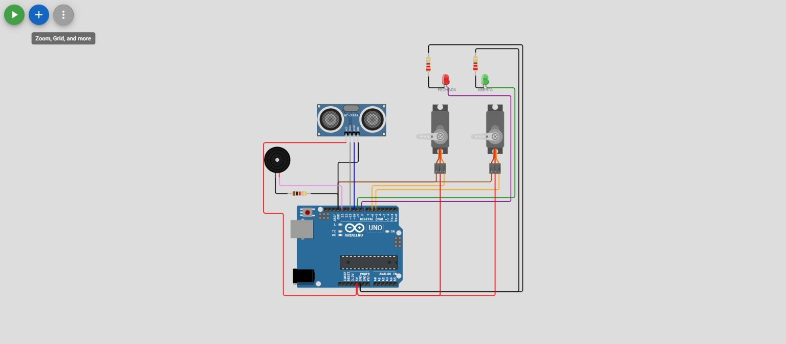

# Projeto-6E — Laboratório Arduino

> Documentação baseada nos arquivos reais deste projeto. A compilação e a simulação ainda não foram confirmadas.

## Objetivo

Analisar as ligações e o comportamento programado deste experimento com Arduino Uno, relacionando os componentes ao código C/C++.

## Componentes do diagrama

- arduino-uno: 1
- servo: 2
- hc-sr04: 1
- led: 2
- resistor: 3
- buzzer: 1

**Total:** 10 componentes e 19 conexões declaradas.

## Recursos encontrados no código

- saída digital
- sinal sonoro
- medição de pulso ultrassônico
- controle de servomotor
- monitor serial

## Arquivos para estudo

- [Diagrama Wokwi](diagram.json)
- [Código Arduino](src/main.cpp)
- [Configuração PlatformIO](platformio.ini)

## Como estudar

1. Abra a pasta deste projeto no VS Code com PlatformIO.
2. Compare os componentes e as ligações de `diagram.json` com os pinos declarados em `src/main.cpp`.
3. Execute a compilação pelo PlatformIO e abra a simulação Wokwi, se estiver configurada.
4. Observe entradas, saídas e respostas do circuito.
5. Registre resultados e proponha uma alteração simples no código.

**Atividade:** explique o papel de cada componente e o funcionamento do `setup()` e do `loop()`.

## Captura do circuito no Wokwi

Captura autêntica do editor web a partir do diagrama original. **Simulação não executada nesta captura.** [Origem e versão dos diagramas](../../docs/GUIA_IMAGENS.md).

[← Voltar ao catálogo](../../README.md)
